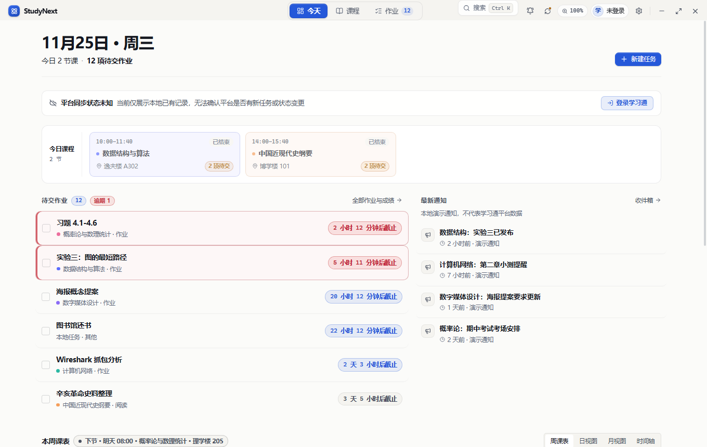
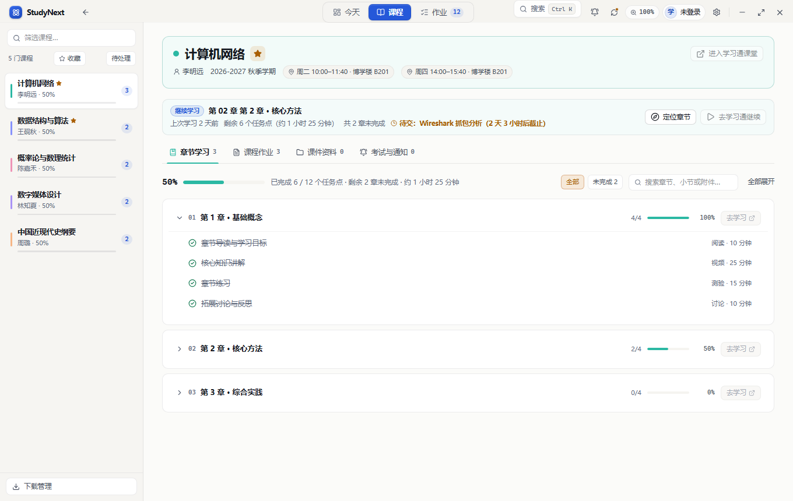
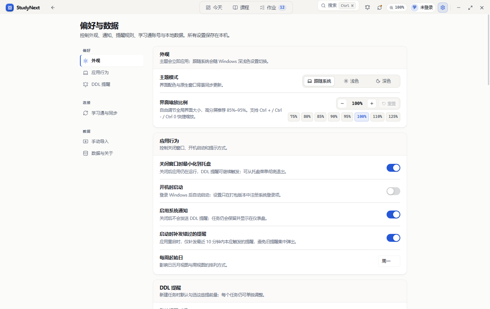
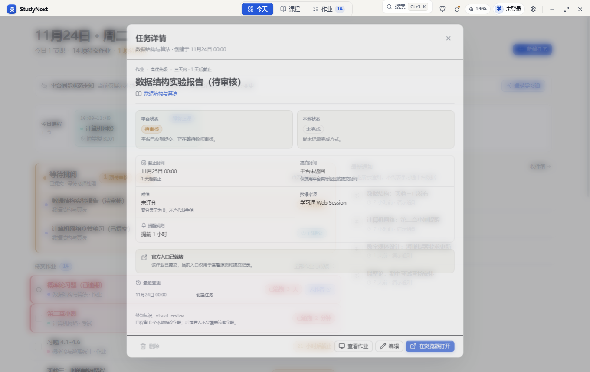

<div align="center">


# StudyNext

**学习通深度集成的桌面学习工作台**

课程、作业、DDL、资料与提醒，在一个窗口里完成。

[](LICENSE)


[产品概览](#-产品概览) · [核心功能](#-核心功能) · [界面](#-界面) · [快速开始](#-快速开始) · [安全边界](#-安全与数据边界) · [文档](#-文档导航)

</div>

---

## 产品概览

StudyNext 是一个面向 Windows 的学习通桌面客户端。它把分散在课程页、作业页、资料页和通知页里的信息整理到一个本地优先的工作台里，让你不用在多个浏览器标签之间来回切换。

它不是学习通官方客户端，也不是学习通网页的简单包装器。课程与作业数据通过**用户本人已经登录的学习通 Web Session**只读同步；作业编辑、附件上传、草稿保存和提交仍然在隔离的官方页面内由用户本人完成。

> **当前版本：`v0.5.0`（开发基线）**
> 产品边界、实现状态和真实能力以 [AGENTS.md](AGENTS.md)、[docs/ARCHITECTURE.md](docs/ARCHITECTURE.md)、[docs/STATUS.md](docs/STATUS.md) 为准。

## 核心功能

| 模块             | 能做什么                                                                                                                                                       |
| ---------------- | -------------------------------------------------------------------------------------------------------------------------------------------------------------- |
| **今天**         | 今日课程、待交作业、待审核、近期截止和通知聚合在一页；周/日/月/时间轴课表视图；顶部显示学习通连接状态、最近同步时间和自动刷新状态。                            |
| **课程**         | “课程 → 章节 → 小节 → 学习点”浏览进度；章节筛选、课程内搜索、未完成任务优先排序；资料按教学班合并去重。                                                        |
| **作业**         | 平台六态（未提交/已提交/待审核/已批阅/已完成/未知）与本地状态分离；截止规划、提醒规则、成绩与教师批语、附件下载；提交后按课程自动重新同步。                    |
| **资料与下载**   | Portal 会话流式下载，支持进度、取消、重试和再次下载；下载记录与本地文件校验持久化在 SQLite；PDF、图片、文本可应用内预览。                                      |
| **学习通集成**   | `WebContentsView` 持久分区承载官方页面；课程、作业、考试、章节、通知、资料和课表通过页面解析读取；不向远程页面注入 preload。                                   |
| **多账号与提醒** | 账号凭据使用 Windows DPAPI（Electron `safeStorage`）加密保存；每个学习通账号使用独立 SQLite 工作区；DDL 提醒支持进程内调度和 Windows Task Scheduler 无头检查。 |
| **导入与搜索**   | CSV/ICS/JSON 学习快照手动导入；浅色/深色主题、100%/125%/150% 缩放、`Ctrl+K` 命令面板与全局搜索。                                                               |

## 界面

<p align="center">
  
</p>

| 课程                                             | 作业                                           |
| ------------------------------------------------ | ---------------------------------------------- |
|  |  |

| 设置                                              | 待审核与任务详情                                                 |
| ------------------------------------------------- | ---------------------------------------------------------------- |
|  |  |

更多浅色、深色和缩放截图见 [docs/screenshots/v0.5](docs/screenshots/v0.5)。

## 快速开始

要求 **Windows 10/11**、**Node.js 22+**、**npm 10+**。

```powershell
git clone https://github.com/xiaomai1011/StudyNext.git
cd StudyNext
npm install
npm run dev
```

常用命令：

```powershell
npm run typecheck    # 主进程 + 渲染进程类型检查
npm test             # Vitest 单元测试
npm run test:e2e     # 构建后运行 Playwright Electron E2E
npm run build        # 类型检查 + 生产构建
npm run build:win    # 构建 Windows NSIS 安装包到 release/
npm run verify:release
npm run format:check
```

### 构建 Windows 安装包

```powershell
npm run build:win
```

构建产物位于 `release/`，其中包括 `StudyNext-Setup-<version>.exe` 和 `win-unpacked/`。安装包当前未签名；运行 `npm run verify:release` 可校验安装包、blockmap 和 manifest 的大小与哈希。

如果当前环境设置了 `ELECTRON_RUN_AS_NODE=1`，启动 GUI 或 E2E 前必须清除。Playwright 需要：

```text
--no-sandbox --disable-gpu --user-data-dir=<工作区内可写目录>
```

并设置 `STUDYNEXT_DATA_DIR` 指向同一目录，避免系统临时目录的 Chromium 锁权限问题。

## 安全与数据边界

- 远程页面只能在隔离的 `WebContentsView` 中打开，所有 URL 进入 Portal 前后都要经过白名单校验。
- 渲染器不直接访问学习通接口，不持有登录态，不接触 Node.js、SQLite 或通用 IPC。
- 账号、密码、Cookie、Token、完整敏感 URL 不写入日志、源码、测试快照或导出文件。
- 账号凭据通过 Electron `safeStorage`（Windows DPAPI）加密保存；每个账号使用独立 SQLite 工作区。
- 学习通接入基于用户本人 Web Session，不代表获得学习通官方 OAuth 或机构 API 授权。
- 不做自动刷课、伪造学习记录、自动考试、验证码绕过、MFA 绕过、反爬规避或监考绕过。
- AI 解题功能已从产品中移除；旧数据库中的 `questions`/`ai_config` 仅做只读迁移兼容。

## 技术架构

| 层       | 技术                                                                                 |
| -------- | ------------------------------------------------------------------------------------ |
| 桌面框架 | Electron 45.3.0                                                                      |
| 构建     | electron-vite 6、Vite 8                                                              |
| UI       | React 19、Tailwind 4、自定义 CSS design tokens                                       |
| 语言     | TypeScript 5.9（`strict`、`noUncheckedIndexedAccess`、`exactOptionalPropertyTypes`） |
| 数据     | Electron 内置 `node:sqlite`（`DatabaseSync`），不引入原生模块                        |
| 进程边界 | main / preload（`contextBridge`）/ sandboxed renderer / 官方网页视图                 |
| 测试     | Vitest 单元测试、Playwright Electron E2E                                             |
| 打包     | electron-builder（Windows NSIS）                                                     |

应用分为四层：Electron 主进程负责窗口、SQLite、Portal、同步和系统提醒；preload 只暴露最小、类型化的 IPC API；React renderer 不接触 Node.js；学习通页面在隔离的 `WebContentsView` 中运行。详细架构见 [docs/ARCHITECTURE.md](docs/ARCHITECTURE.md)。

## 项目结构

```text
src/main/        主进程：窗口、托盘、SQLite、IPC、Portal、同步、通知
src/preload/     contextBridge 暴露的最小类型化 API
src/renderer/    React 渲染器：今天 / 课程 / 作业三顶层工作区
src/shared/      领域类型、IPC 合约、纯函数与共享常量
tests/unit/      Vitest 单元测试
tests/e2e/       Playwright Electron E2E
docs/            架构、集成、测试、状态与设计文档
build/           NSIS 安装脚本与图标
scripts/         发布清单与校验脚本
```

## 当前状态

- 版本：`0.5.0`，当前开发分支 `v0.4.0-development`。
- 最近本地验证：`npm run typecheck` 通过；`npm test` 444/444（51 文件）通过；`npm run test:e2e` 110/110 通过；`npm run build` 通过。
- 安装包尚未签名，尚未接入自动更新；真实 Windows 安装/覆盖升级/卸载仍需在目标环境验收。
- 学习通页面解析依赖 DOM/HTML，平台改版可能导致部分字段失败，解析器需要保持可观测和可回退。
- 真实学习通账号的完整流程验收、复杂课表、资料分页和部分作业的未知字段仍需继续验证。

## 文档导航

- [AGENTS.md](AGENTS.md)：工程约束与 Agent 工作指南
- [docs/ARCHITECTURE.md](docs/ARCHITECTURE.md)：进程架构、数据模型、同步与提醒设计
- [docs/FEATURE_MAP.md](docs/FEATURE_MAP.md)：功能实现方式与真实程度
- [docs/CHAOXING_INTEGRATION.md](docs/CHAOXING_INTEGRATION.md)：学习通能力矩阵、协议与安全边界
- [docs/WINDOWS_REMINDERS.md](docs/WINDOWS_REMINDERS.md)：系统级 DDL 提醒实现与限制
- [docs/TESTING.md](docs/TESTING.md)：测试策略、命令与最近基线
- [docs/ISSUES.md](docs/ISSUES.md)：已知问题与工程教训
- [docs/ROADMAP.md](docs/ROADMAP.md)：后续路线与验收原则
- [docs/STATUS.md](docs/STATUS.md)：当前开发状态与待办
- [docs/CHANGELOG.md](docs/CHANGELOG.md)：版本变更记录

## 免责声明

StudyNext 是非官方、非营利的个人技术项目，与学习通及其关联公司无关。请只使用你本人的账号，并遵守学校与平台的使用规则。项目不会绕过验证码、MFA、监考或教师权限，也不对因使用本软件产生的账号、数据或纪律风险承担责任。

## 许可证

MIT，见 [LICENSE](LICENSE)。
