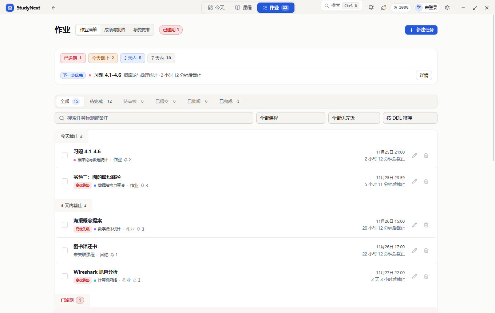

# StudyNext

> 现代化学习通桌面客户端：把课程、作业、资料与 DDL 收进一个本地优先的 Windows 桌面应用。

StudyNext 不是学习通官方客户端。课程与作业数据通过**用户本人已登录的学习通 Web Session**只读同步，作业编辑、附件上传、草稿保存与提交均在隔离的官方页面内由用户本人完成；应用不绕过验证码、MFA、监考或教师权限，也不伪造学习记录、签到或提交。

当前开发基线为 **v0.5.0**，产品方向与实现边界以 [AGENTS.md](AGENTS.md)、[docs/ARCHITECTURE.md](docs/ARCHITECTURE.md)、[docs/STATUS.md](docs/STATUS.md) 为准。

## 功能

### 今天

- 今日课程、待办、待审核/已提交、近期截止与通知聚合在一页。
- 周课表固定五时段展示，支持周/日/月/时间轴视图。
- 顶部状态带显示学习通连接状态、最近同步时间与自动刷新状态。

### 课程

- 课程工作台按“课程 → 章节 → 小节 → 学习点”浏览学习进度。
- 章节筛选、课程内搜索、未完成任务优先排序。
- 课程资料按教学班合并去重，支持文件夹、链接与文件条目。
- 任务点进度来自平台真实任务点；无任务点课程保留章节与资料，不伪造 100%。

### 作业

- 平台六态：`not_submitted`、`submitted`、`pending_review`、`reviewed`、`done`、`unknown`。
- 平台状态与本地完成状态分离；逾期、待审核、已批阅、已完成分组展示。
- 截止规划条、提醒规则、成绩与教师批语、作业附件下载。
- 作业正文、附件上传、暂时保存与提交都在隔离的官方页面完成，提交后自动按课程重新同步。

### 资料与下载

- 主进程通过 Portal 会话流式下载，支持进度、取消、重试与再次下载。
- 下载记录与本地文件校验表持久化在 SQLite。
- PDF、图片、文本可在应用内预览；Office、压缩包与链接使用系统方式打开。

### 学习通集成

- 使用 `WebContentsView` 持久分区承载官方页面，不向远程页面注入 preload，不暴露 Node.js、文件系统或通用 IPC。
- 课程、作业、考试、章节、通知、资料与课表通过页面解析读取。
- 官方 OAuth/机构 API 尚未获得授权与文档，当前不将其标记为可用能力；详细边界见 [docs/CHAOXING_INTEGRATION.md](docs/CHAOXING_INTEGRATION.md)。

### 多账号与提醒

- 账号凭据使用 Windows DPAPI（Electron `safeStorage`）加密保存，可保存多个账号。
- 每个学习通账号使用独立 SQLite 工作区，按平台 UID 隔离，不覆盖历史库。
- DDL 提醒同时支持进程内调度与 Windows 任务计划程序无头检查；应用完全退出后仍可由系统任务触发提醒（需系统任务已注册）。
- 通知投递失败会持久化并按 1/5/15 分钟有界退避，最多 4 次；详见 [docs/WINDOWS_REMINDERS.md](docs/WINDOWS_REMINDERS.md)。

### 其他

- CSV/ICS/JSON 学习快照手动导入，不冒充实时同步。
- 浅色/深色主题、100%/125%/150% 界面缩放、`Ctrl+K` 命令面板与全局搜索。
- Windows 启动项与托盘常驻可选，关闭窗口最小化到托盘。

## 界面

| 今天                                           | 课程                                             |
| ---------------------------------------------- | ------------------------------------------------ |
|  |  |

| 作业                                           | 设置                                              |
| ---------------------------------------------- | ------------------------------------------------- |
|  |  |

更多截图见 [docs/screenshots/v0.5](docs/screenshots/v0.5)。

## 技术栈

| 层       | 技术                                                                                 |
| -------- | ------------------------------------------------------------------------------------ |
| 桌面框架 | Electron 45.3.0                                                                      |
| 构建     | electron-vite 6、Vite 8                                                              |
| UI       | React 19、Tailwind 4、自定义 CSS 设计 token                                          |
| 语言     | TypeScript 5.9（`strict`、`noUncheckedIndexedAccess`、`exactOptionalPropertyTypes`） |
| 数据     | Electron 内置 `node:sqlite`（`DatabaseSync`），不引入原生模块                        |
| 测试     | Vitest（单元）、Playwright（Electron E2E）                                           |
| 打包     | electron-builder（Windows NSIS）                                                     |

## 快速开始

要求 Windows 10/11、Node.js 22+、npm 10+。

```powershell
npm install
npm run dev
```

常用命令：

```powershell
npm run typecheck    # 主进程 + 渲染进程类型检查
npm test             # Vitest 单元测试
npm run test:e2e     # 构建后运行 Playwright Electron E2E
npm run build        # 类型检查 + 生产构建
npm run build:win    # 构建 Windows NSIS 安装包到 release/
npm run verify:release
npm run format:check
```

如果当前环境设置了 `ELECTRON_RUN_AS_NODE=1`，启动 GUI 或 E2E 前必须清除。Playwright 需要：

```text
--no-sandbox --disable-gpu --user-data-dir=<工作区内可写目录>
```

并设置 `STUDYNEXT_DATA_DIR` 指向同一目录，避免系统临时目录的 Chromium 锁权限问题。

## 数据位置

默认数据目录按以下优先级选择：

1. `STUDYNEXT_DATA_DIR` 环境变量；
2. `%LOCALAPPDATA%\StudyNext`；
3. `%APPDATA%\StudyNext`。

目录内主要文件：

- `studynext.sqlite`：主数据库；
- `account-workspaces.json`：多账号工作区注册表；
- `workspaces/`：每账号独立数据库；
- `window-state.json`：窗口尺寸与位置；
- `backups/`：手动/迁移备份。

应用不会自动把数据写入系统临时目录。删除或迁移数据前请先备份整个数据目录。

## 安全与边界

- 远程页面只能在隔离的 `WebContentsView` 中打开，所有 URL 进入 Portal 前后都要经过白名单校验。
- 渲染器不直接访问学习通接口，不持有登录态，不接触 Node.js。
- 不记录账号、密码、Cookie、Token 或完整敏感 URL。
- 学习通能力以 [docs/CHAOXING_INTEGRATION.md](docs/CHAOXING_INTEGRATION.md) 的矩阵为准；未配置、失败或部分成功必须如实显示。
- AI 解题功能已从产品中移除；旧数据库中的 `questions`/`ai_config` 仅做只读迁移兼容，不得恢复入口。

## 项目结构

```text
src/main/        主进程：窗口、托盘、SQLite、IPC、Portal、同步、通知
src/preload/     contextBridge 暴露的最小类型化 API
src/renderer/    React 渲染器：今天/课程/作业三顶层工作区
src/shared/      领域类型、IPC 合约、纯函数与共享常量
tests/unit/      Vitest 单元测试
tests/e2e/       Playwright Electron E2E
docs/            架构、集成、测试、状态与设计文档
build/           NSIS 安装脚本与图标
scripts/         发布清单与校验脚本
```

## 文档

- [AGENTS.md](AGENTS.md)：工程约束与 Agent 工作指南
- [docs/ARCHITECTURE.md](docs/ARCHITECTURE.md)：进程架构、数据模型、同步与提醒设计
- [docs/FEATURE_MAP.md](docs/FEATURE_MAP.md)：功能实现方式与真实程度
- [docs/CHAOXING_INTEGRATION.md](docs/CHAOXING_INTEGRATION.md)：学习通能力矩阵、协议与安全边界
- [docs/WINDOWS_REMINDERS.md](docs/WINDOWS_REMINDERS.md)：系统级 DDL 提醒实现与限制
- [docs/TESTING.md](docs/TESTING.md)：测试策略、命令与最近基线
- [docs/ISSUES.md](docs/ISSUES.md)：已知问题与工程教训
- [docs/ROADMAP.md](docs/ROADMAP.md)：后续路线与验收原则
- [docs/STATUS.md](docs/STATUS.md)：当前开发状态与待办
- [docs/CHANGELOG.md](docs/CHANGELOG.md)：版本变更记录

## 已知限制

- 安装包尚未签名，未接入自动更新。
- 真实 Windows 安装/覆盖升级/卸载与真实学习通账号全流程验收仍需在目标环境执行。
- 学习通页面结构变化可能导致解析失败；解析器需要随平台页面更新维护。
- 部分作业不返回提交时间；详情页未完整读取时保持 `unread`，不猜测。
- 资料分页、复杂课表（单双周/调休/多教师）等场景仍需继续验证与建模。
- 应用图标为占位品牌图标，正式发布前应做视觉定稿。

## 许可证

MIT，见 [LICENSE](LICENSE)。
