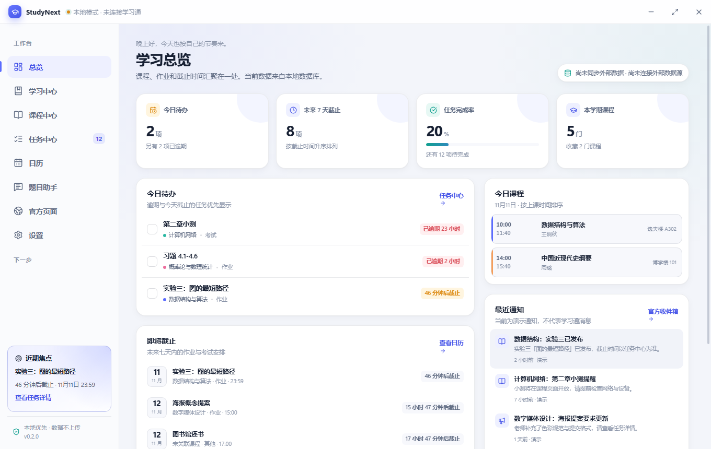
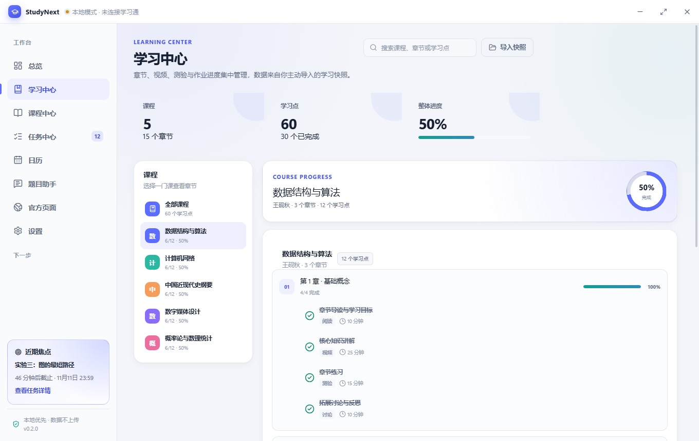
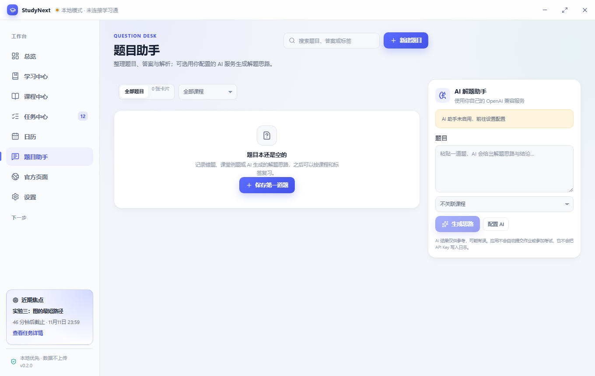

# StudyNext

StudyNext 是一个面向 Windows 10/11 的学习通第三方桌面客户端。它把课程、任务、DDL、日历和官方网页入口放进一个本地优先的桌面应用，重点解决网页版信息分散、截止时间不集中、提醒不可控的问题。

> 当前版本是 **0.2.0（桌面客户端 + 学习中心 + 题目助手）**。课程、任务、章节进度、题库、通知与演示数据都保存在本机；没有配置学习通授权数据源时，应用会明确显示“未配置”，不会伪造同步结果。



| 学习中心                                      | 题目助手                                          |
| --------------------------------------------- | ------------------------------------------------- |
|  |  |

## 已实现功能

### 桌面体验

- Electron 无边框窗口、窗口状态记忆、最小尺寸、深浅色/跟随系统主题
- 自定义标题栏、最小化/最大化/关闭、关闭到系统托盘
- 托盘菜单：打开应用、今日待办、任务中心、课程中心、提醒开关、数据目录、退出
- 全局 Toast 反馈、空状态、加载与错误页
- 所有数据本地持久化，默认不上传

### 首页仪表盘

- 今日待办、未来 7 天截止、任务完成率、本学期课程统计
- 今日课程（按开始时间排序）
- 最近通知（明确标注为演示数据，不代表学习通消息）
- 最近同步时间与数据来源、近期待办快捷入口

### 课程中心

- 课程卡片网格、课程名称/代码/教师搜索
- 必修/通识/选修分类筛选、仅看收藏
- 收藏切换、课程详情、课表信息
- 跳转学习通官方页面入口

### 学习中心

- 按课程浏览章节与学习点，合并展示阅读、视频、测验、讨论任务与预计耗时
- 学习点完成状态、章节完成数与课程总进度实时计算
- 课程侧栏搜索、课程切换、章节折叠区域与进度环
- 通过 JSON 学习快照导入课程、章节、学习点、作业和考试；明确标注“本地快照 · 非实时同步”
- 未导入快照时提供明确的空状态与导入入口，不伪造远程课程数据

### 题目助手

- 本地题目卡新增、编辑、删除、搜索，支持课程、标签、答案与解析
- 可按课程筛选，记录来源（手动录入、导入、AI 生成）
- 可选接入用户自己的 OpenAI 兼容 API：自定义 Base URL、模型与 Key
- AI Key 使用 Electron `safeStorage` 加密保存在本机；不会写入日志，也不会随任务数据上传
- 仅当用户点击“生成思路”时才把当前题目发送给所配置的服务商；结果仅供参考，不自动提交作业或考试

### 任务中心

- 任务新增、查看、编辑、完成、删除
- 课程归属、优先级、任务类型、截止时间、备注
- 按截止时间排序，按课程/状态/优先级筛选
- DDL 提醒规则编辑：提前 3 天、1 天、3 小时、1 小时及自定义分钟数
- 逾期、今天、7 天内、之后分组

### DDL 提醒

- 使用 Electron 主进程 `Notification` 发送系统通知
- 提醒规则持久化到 SQLite；任务完成、删除或截止时间变更时同步调整
- 通知投递去重（`notification_deliveries`），同一任务同一提醒不会重复弹出
- 应用运行期间每 30 秒检查一次；**应用完全退出后不会继续提醒**
- 重新启动时补发最近 10 分钟内错过的提醒（可在设置中关闭）
- 系统通知不可用时仍会发送应用内提醒事件，不会静默丢失 DDL
- 启动补发、下一条提醒时间会在设置页和首页同步信息中显示
- 时区处理基于本机时区，日期在数据库中统一存储为 ISO 时间

### 日历

- 月视图和周视图
- 月视图展示课程圆点与任务条目；周视图展示课程时间块与任务
- 点击日期查看当天课程与截止任务；点击任务打开详情
- 支持上一月/下一月、今天、返回当月

### 学习通兼容层

- 官方入口管理（内置入口 + 自定义 HTTPS 入口，可启用/停用）
- 隔离的持久化浏览器会话：`persist:studynext-portal`
- 使用 `WebContentsView` 打开官方页面，启用 sandbox、contextIsolation，关闭 nodeIntegration/webviewTag
- 禁止远程页面访问 Node.js、本地数据库或预加载脚本
- URL 白名单：仅允许 `https://*.chaoxing.com` 与 `https://*.xuexitong.com`
- 拦截危险跳转、新窗口、webview 挂载、下载与权限请求
- 登录状态提示、失败提示、在系统浏览器中打开的回退入口
- 未配置授权数据源时显示 `not_configured`，并保留 CSV/ICS 手动导入

### 数据导入

- JSON 学习快照：导入 `courses/chapters/points/homeworks/exams`，支持根节点或 `data` 包装，按稳定外部 ID 去重
- 快照课程、章节、学习点和作业以 `import` 来源保存；同步状态明确显示“本地快照”，不会伪装成学习通实时授权同步
- CSV：支持中英文字段别名，字段至少包含标题、截止时间；可选课程、优先级、类型、提醒
- ICS：解析 VEVENT、DATE/DATE-TIME、UTC `Z`、`TZID`、DESCRIPTION、CATEGORIES
- 导入按外部 UID/去重键避免重复任务；导入结果区分成功、部分成功和失败
- 导入失败返回结构化错误，不会把失败描述为成功

### 设置

- 主题、关闭到托盘、开机启动（仅打包版注册系统登录项）
- 通知开关、默认提醒时间、提醒补发、每周起始日
- 测试通知
- 学习通连接状态、官方入口管理、数据目录、演示数据恢复
- AI 解题助手配置（启用/停用、Base URL、模型、API Key、清除 Key）
- JSON 学习快照导入与导入结果
- 应用版本与运行平台信息

## 技术栈

| 层     | 技术                                       | 选择原因                                                                                                          |
| ------ | ------------------------------------------ | ----------------------------------------------------------------------------------------------------------------- |
| 桌面壳 | Electron 38.8.6                            | Windows 稳定、支持 `WebContentsView` 与 Node 内置 SQLite；Electron 45 在当前测试环境启动阶段崩溃，已回退到 38.8.6 |
| 构建   | electron-vite 6 + Vite 8                   | 主进程/预加载/渲染器统一构建，开发热更新                                                                          |
| UI     | React 19 + TypeScript 5.9 + Tailwind CSS 4 | 严格类型、组件化、快速迭代                                                                                        |
| 数据   | Node `node:sqlite`（`DatabaseSync`）       | 免原生模块 ABI 编译，打包简单，适合本地单用户数据库                                                               |
| 校验   | Zod 4                                      | IPC 边界运行时校验                                                                                                |
| AI     | OpenAI 兼容 HTTP API + safeStorage         | 用户自带 Key，支持自定义 Base URL/模型；Key 加密存储，不内置任何服务商凭据                                        |
| 日期   | date-fns 4 + date-fns-tz 3                 | 本地时区、日历运算、ICS TZID                                                                                      |
| 测试   | Vitest 5 + Playwright 1.65                 | 领域/存储/调度单测 + 真实 Electron E2E                                                                            |
| 打包   | electron-builder 26                        | NSIS Windows 安装包                                                                                               |

## 快速开始

要求：Windows 10/11、Node.js 22+、npm 10+。

```powershell
cd studynext
npm install
npm run dev
```

如果 npm 的安全策略拦截了 Electron 的安装脚本，electron 目录可能缺少二进制，可手动执行：

```powershell
node node_modules/electron/install.js
```

如果终端设置了 `ELECTRON_RUN_AS_NODE=1`，启动 GUI 前需要清除：

```powershell
Remove-Item Env:ELECTRON_RUN_AS_NODE
```

### 常用命令

```powershell
npm run dev        # 开发模式
npm run typecheck  # 严格 TypeScript 检查
npm test           # Vitest 单元测试
npm run test:e2e   # 构建后运行 Playwright Electron E2E
npm run build      # 类型检查 + 生产构建
npm run build:win  # 生成 Windows NSIS 安装包
```

### 已生成构建产物

- 安装包：`release/StudyNext-Setup-0.2.0.exe`（106,052,543 bytes，约 101.1 MiB）
- 免安装目录：`release/win-unpacked/StudyNext.exe`
- SHA-256：`8C409023E37839F1623414D1D5642ECB64FD7AFD68883C8F92279BC59D2226D7`

安装包当前未做代码签名。产物已用真实 Electron 启动验证：打包版可正常加载 asar 内的主进程、preload 与渲染资源。

### 数据位置

默认数据库：

```text
%LOCALAPPDATA%\StudyNext\studynext.sqlite
```

窗口状态：

```text
%LOCALAPPDATA%\StudyNext\window-state.json
```

可用环境变量覆盖数据目录（便于测试或便携使用）：

```powershell
$env:STUDYNEXT_DATA_DIR = "D:\StudyNextData"
npm run dev
```

### 演示数据

首次启动自动写入 5 门课程、15 项任务、15 个章节与 60 个学习点。设置 → 数据 → “恢复演示数据”可一键重建课程、章节、学习点和任务；题库不会被清空。执行前请确认当前演示数据不再需要。

## 测试与验收

| 验收项                    | 实现/验证                                                                                                                                           |
| ------------------------- | --------------------------------------------------------------------------------------------------------------------------------------------------- |
| 无学习通账号可启动        | E2E 启动真实 Electron，无登录步骤                                                                                                                   |
| 首页显示模拟数据          | E2E 断言 5 门课程、通知与任务统计                                                                                                                   |
| 任务增删改查              | E2E 新建、编辑、完成、删除                                                                                                                          |
| 重启数据一致              | E2E 关闭并重新启动后断言任务仍在                                                                                                                    |
| DDL 排序正确              | 单元测试覆盖 `sortTasksByDue`、逾期/今天/未来分组                                                                                                   |
| 修改截止后提醒更新        | 单元测试覆盖提醒重算与旧投递清理                                                                                                                    |
| 不产生重复通知            | 单元测试覆盖投递 claim/release 与去重                                                                                                               |
| 网络/权限失败不假成功     | `SyncService` 未配置固定返回 `not_configured`，导入返回结构化失败                                                                                   |
| 第三方页面无 Electron API | 单测校验安全参数；Portal E2E 在真实 WebContentsView 内断言 `require/process/module/window.studynext/ipcRenderer` 均不可见，并验证白名单外跳转被拦截 |
| 生成 Windows 安装包       | `npm run build:win` 生成 NSIS 安装程序                                                                                                              |

最终自动化结果：Vitest **8 个文件 / 40 项全部通过**；Playwright **5 个规格全部通过**（应用主流程、学习中心/题库/快照导入、Portal 隔离、响应式布局、浅色/深色视图截图）。详细记录见 [测试报告](docs/TEST_REPORT.md)。

## 项目结构

```text
studynext/
├─ src/
│  ├─ main/
│  │  ├─ index.ts              # 应用生命周期、窗口、托盘、通知
│  │  ├─ ipc.ts                # IPC 路由与输入校验
│  │  ├─ storage/store.ts      # SQLite schema、迁移、DAO、演示数据
│  │  ├─ notifications/        # DDL 提醒调度与去重
│  │  ├─ integrations/         # CSV/ICS/JSON 快照导入、AI 服务、授权适配器接口
│  │  ├─ portal/               # WebContentsView 隔离、URL 白名单、安全状态
│  │  └─ window-state.ts       # 窗口位置/大小记忆
│  ├─ preload/                 # contextBridge 最小 API
│  ├─ renderer/                # React 页面与组件（学习中心、题库、日历等）
│  └─ shared/                  # 领域类型、常量、领域函数、IPC 合约
├─ tests/
│  ├─ unit/                    # 领域、存储、调度、导入、AI、快照、安全、同步单测
│  ├─ e2e/                     # 真实 Electron：主流程、学习中心、Portal、响应式、视图
│  └─ fixtures/                # Portal 隔离测试用本地 HTTPS 证书
├─ docs/                       # 调研、架构、测试报告、路线图、截图
├─ build/                      # 应用图标
├─ resources/                  # 托盘图标与运行时图标
└─ electron-builder.yml        # NSIS 打包配置
```

## 安全与隐私边界

- 渲染器只通过 `contextBridge` 暴露最小 `window.studynext` API，不暴露通用 `ipcRenderer`。
- 主窗口 `sandbox: true`、`contextIsolation: true`、`nodeIntegration: false`。
- 学习通页面运行在独立 `WebContentsView` 和独立持久化分区中，不注入 preload。
- 远程页面不能读取本地 SQLite、文件系统或 Electron API。
- 登录凭据不写入日志、SQLite 或应用源码；账号登录由官方页面自行处理。
- 不实现自动刷课、伪造签到、考试代答、验证码绕过、反爬规避、私有协议破解或未授权接口访问。
- 未获授权数据同步时显示“未配置/暂不可用”，不伪造成功状态。
- 学习快照是用户主动导入的本地 JSON，不代表已连接学习通；界面会明确标注“本地快照 · 非实时同步”。
- AI Key 使用 `safeStorage` 加密存储；只有用户主动点击生成时才将当前题目发送给所配置的 OpenAI 兼容服务商。
- 数据默认只保存在本机，不主动上传。

## 已知限制

- 学习通开放平台目前没有面向个人开发者公开可申请的 OAuth/课程作业接口；本项目没有接入未授权私有接口。
- 官方网页的 DOM、登录流程与风控由学习通控制，应用只托管页面，不解析页面内容。
- 系统通知依赖 Windows 通知设置；通知中心被关闭时，应用内仍会显示提醒事件，但系统横幅可能不出现。
- 完全退出应用后不会运行提醒；只有重新启动时才补发最近 10 分钟内错过的提醒。
- 月视图中的课程按每周重复规则展示，暂不处理单双周、调休与节假日。
- 学习快照导入是本地数据桥，不包含自动抓取、自动签到、自动答题或学习通私有接口调用。
- 题目助手的 AI 输出可能不准确；应用不会自动提交作业、考试或代替用户作答。
- 当前安装包未做代码签名，Windows SmartScreen 可能显示未知发布者提示。

## 文档

- [交付报告](docs/DELIVERY.md)
- [调研与许可记录](docs/research.md)
- [架构设计](docs/ARCHITECTURE.md)
- [测试报告](docs/TEST_REPORT.md)
- [会话优化落地记录](docs/OPTIMIZATION.md)
- [开发问题记录与开源项目审查](docs/ISSUES.md)
- [下一阶段计划](docs/ROADMAP.md)
- [工程约束与 Agent 指南](AGENTS.md)

## License

MIT。第三方参考项目的许可证与可复用范围见 [docs/research.md](docs/research.md)。
